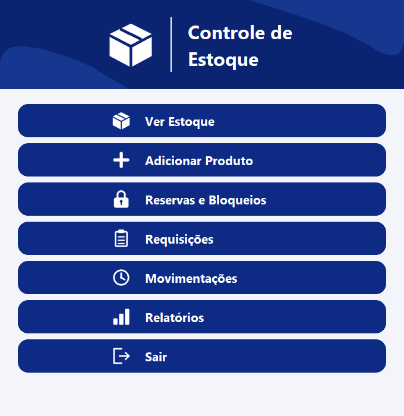
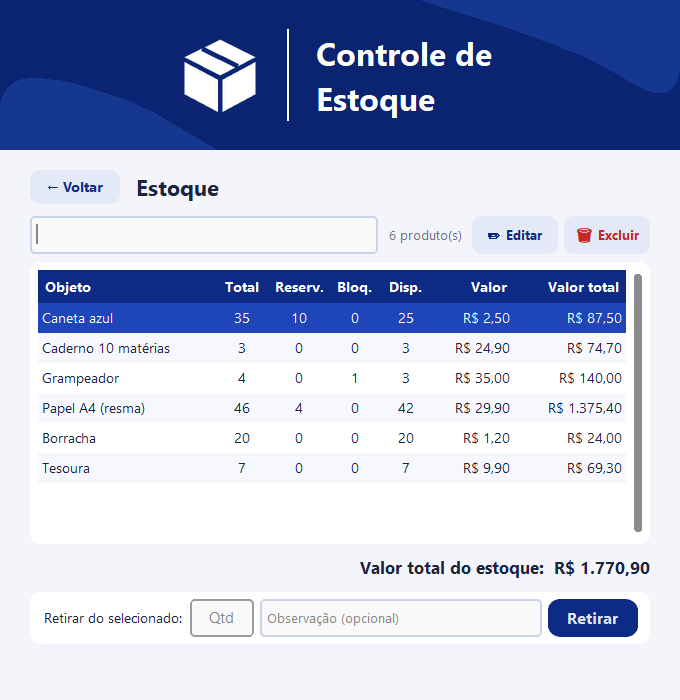
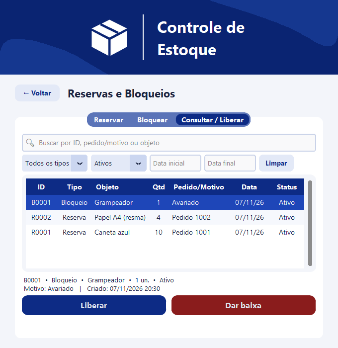
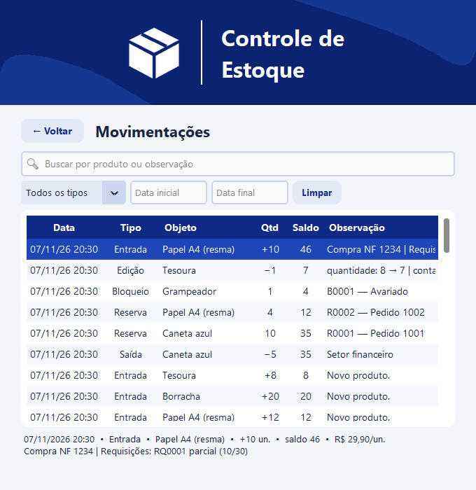
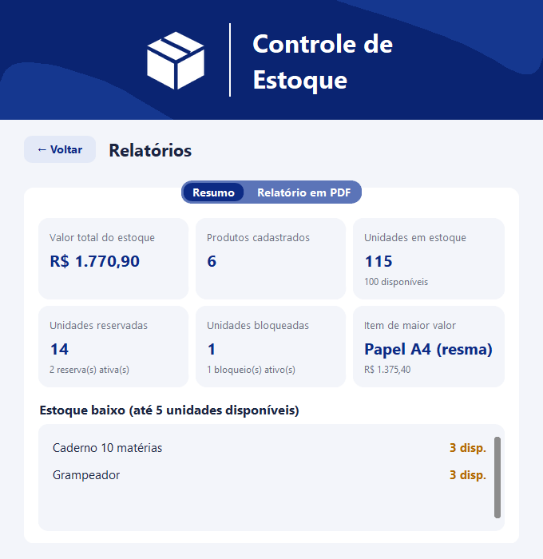

# 📦 Controle de Estoque

Solução para o **Case Prático de Engenharia de Software: Controle de Estoque**. É um sistema em **Python** que
controla, para cada produto, as quantidades **total**, **disponível**, **reservada** e **bloqueada**. Tem
interface gráfica, menu no terminal e uma planilha **Excel** como base de dados.

<p align="center">
  
</p>

**Execução rápida** (Python 3.11+): `python -m pip install -r requirements.txt` → `python tela.py` · Testes: `python -m pytest -v`

---

## 1. Visão geral

O sistema foi pensado para um **estoque de varejo**. Para cada produto, ele mostra a situação atual seguindo uma
regra central:

> **disponível = total − reservado − bloqueado**

Um produto pode ter **várias reservas e bloqueios ao mesmo tempo**, ligados a pedidos ou motivos diferentes. Cada
um tem sua própria identificação (`R0001`, `B0003`…), usada para consultar e liberar.

| Funcionalidade do case | Como foi atendida |
|---|---|
| **Entrada** | Soma unidades a um produto. Se o produto não existir, ele é criado |
| **Saída** | Retira unidades, mas só se houver quantidade **disponível** suficiente |
| **Reservar** | Separa unidades disponíveis para um pedido e gera um ID (`R0001`, `R0002`…) |
| **Bloquear** | Torna unidades indisponíveis (avaria, inspeção, mercadoria ainda não liberada para venda) e gera um ID (`B0001`…) |
| **Liberar** | Encerra a reserva ou o bloqueio pelo ID. As unidades voltam ao disponível |
| **Consultar** | `banco.consultar(produto)` devolve total, disponível, reservado e bloqueado de um produto. Na janela, a busca é instantânea; no terminal, use a opção 3 |

**Exemplo de uso no varejo:** uma mercadoria que acabou de chegar pode ser **bloqueada** até ser conferida e
liberada para venda na loja física ou online. Quando um cliente pede que os produtos sejam separados, eles são
**reservados**. Nos dois casos, o encerramento pode ser feito de duas formas:
- **Liberar:** as unidades voltam a ficar disponíveis.
- **Dar baixa:** as unidades saem do estoque, por exemplo quando a venda se concretiza ou o item avariado é descartado.

### Funcionalidades extras (além do case)

| Extra | O que faz |
|---|---|
| Dar baixa | Encerra uma reserva ou um bloqueio retirando as unidades do estoque |
| Histórico de movimentações | Registra toda operação, com filtros por tipo, texto e período |
| Editar / excluir produto | Corrige nome, quantidade e valor. A exclusão é recusada se houver reservas ou bloqueios ativos |
| Importação de lista | Lê arquivos .xlsx ou .csv, mostrando uma prévia e validando antes de gravar |
| Requisições | Pedidos de produtos, atendidos automaticamente quando o produto dá entrada (da requisição mais antiga para a mais nova) |
| Relatório em PDF | Gráficos de entradas × saídas e de saldo, por produto e período |
| Executável Windows | Gerado com PyInstaller |

Incluí os extras porque o objetivo era um estoque **utilizável numa rotina real de varejo**, não só uma
demonstração. Eles ficam em **módulos separados** (`requisicoes.py`, `importacao.py`, `relatorio.py`) e não mudam
as regras do núcleo. Se precisar, dá para removê-los sem afetar as seis funcionalidades do case.

### Telas

| Estoque | Reservas e Bloqueios |
|---|---|
|  |  |
| **Movimentações** | **Relatórios** |
|  |  |

---

## 2. Arquitetura e estrutura

O projeto é dividido em **três camadas**. A interface só conversa com o usuário, toda regra de negócio fica no
pacote `banco`, e só o módulo `planilha.py` acessa o arquivo Excel.

```
  Interface              Regras de negócio            Persistência
  ─────────              ─────────────────            ────────────
  tela.py      ──┐       banco/produtos.py    ──┐
  (janela)       ├──►    banco/reservas.py      ├──►  banco/planilha.py ──► estoque.xlsx
  estoque.py   ──┘       banco/requisicoes.py   │
  (terminal)             banco/importacao.py  ──┘
                         banco/historico.py  (registra toda operação)
```

```
├── tela.py              Janela gráfica (CustomTkinter)
├── estoque.py           Menu no terminal
├── banco/               Regras do estoque (um assunto por arquivo)
│   ├── config.py          Nome do arquivo, abas, colunas, tipos e status
│   ├── modelos.py         Formato dos dados e a exceção ErroEstoque
│   ├── utilidades.py      Formatação, conversão e validação de quantidades/valores
│   ├── planilha.py        Abrir, criar e salvar o Excel (gravação atômica); cálculo do saldo
│   ├── produtos.py        Entrada, saída, consultar, editar, excluir, listar
│   ├── reservas.py        Reservar, bloquear, liberar, dar baixa
│   ├── historico.py       Registro das movimentações
│   ├── requisicoes.py     Pedidos de produtos (extra)
│   ├── importacao.py      Importar lista .xlsx/.csv (extra)
│   └── relatorio.py       Relatório em PDF com gráficos (extra)
├── tests/               Testes automatizados (pytest)
├── docs/imagens/        Capturas de tela usadas neste README
├── requirements.txt     Bibliotecas
├── gerar_exe.bat        Gera o executável Windows (opcional)
└── preparar_github.py   Ferramenta de desenvolvimento: copia o projeto, sem dados, para publicação
```

### Modelo de dados (abas da planilha)

| Aba | Colunas | Papel |
|---|---|---|
| **Estoque** | Objeto · Quantidade · Valor | Total físico de cada produto |
| **Reservas e Bloqueios** | ID · Tipo · Objeto · Quantidade · Pedido/Motivo · Data · Status · Data Fim | Uma linha por reserva ou bloqueio. Status: Ativo, Liberado ou Baixa |
| **Movimentações** | Data · Tipo · Objeto · Quantidade · Saldo · Valor · Observação | Histórico de todas as operações |
| **Requisições** | ID · Objeto · Quantidade · Atendida · Solicitante · Observação · Data · Status · Data Atendimento | Pedidos de produtos (extra) |

### Fluxo de uma operação que altera dados (o mesmo em todas)

```
1. validar entrada → quantidade inteira > 0, valor ≥ 0       (senão: ErroEstoque, nada é gravado)
2. abrir()         → carrega a planilha na memória
3. validar regra   → produto existe? há disponível suficiente? o ID está ativo?
4. alterar         → muda as células na memória e registra no histórico
5. salvar()        → só aqui o arquivo é gravado, com todas as abas juntas:
                     grava em estoque.xlsx.tmp e só no fim troca pelo original (atômico)
```

---

## 3. Principais decisões técnicas

**Excel como base de dados.** Escolhi o Excel por ser acessível no meio corporativo. A equipe pode conferir os
dados sem escrever consultas SQL, usar fórmulas e, no futuro, automatizar com VBA. Para um estoque de varejo de
pequeno e médio porte, essa transparência vale mais do que o desempenho. **O custo:** o Excel não tem transações
nem controle de acesso simultâneo, e a gravação fica lenta com muitos registros (ver Limitações). Por isso, toda a
leitura e gravação está isolada em `planilha.py`. Trocar por um banco de dados afeta só esse módulo.

**O disponível é calculado, não armazenado.** O produto tem três dados próprios (objeto, quantidade e valor), e o
disponível **deriva** deles e das reservas e bloqueios ativos. Se o disponível fosse guardado numa coluna, haveria
duas fontes para a mesma informação. Um bug, uma falha no meio da operação ou uma edição manual na planilha
poderiam deixá-las diferentes, e o produto apareceria como disponível e indisponível ao mesmo tempo. Calculando
sempre na hora, isso não acontece (*fonte única da verdade*). O custo é ler as reservas ativas a cada consulta,
o que é aceitável nesta escala.

**Cada reserva e cada bloqueio é um registro com ID.** Guardar só um número somado no produto ("reservado: 25")
não permitiria saber **qual pedido** reservou cada parte, nem liberar uma reserva específica. Com uma linha por
registro, é possível ter vários registros simultâneos, consultar e liberar por ID e manter o histórico. Os IDs são
sequenciais por tipo (`R0001`, `B0001`) e **nunca são reaproveitados**, para que um ID antigo sempre identifique o
mesmo registro.

**Duas formas de encerrar: Liberar e Dar baixa.** O case pede a liberação (as unidades voltam ao disponível). Mas,
na prática, uma reserva costuma terminar em **venda**, e um bloqueio por avaria em **descarte**. Sem a baixa, seria
preciso liberar e depois retirar, em dois passos, com o risco de outra operação usar as unidades no meio do caminho.

**Validar tudo antes de gravar.** Toda operação valida as entradas e as regras **antes** de alterar qualquer
coisa, e grava o arquivo **uma única vez** no final. Se algo falha, uma exceção própria (`ErroEstoque`, com
mensagem clara em português) interrompe a operação, e o arquivo continua exatamente como estava. As validações de
quantidade ficam **na camada de regras**, não só na tela. Assim, nenhum caminho (tela, terminal, testes ou uma
futura API) consegue gravar uma quantidade inválida.

**Gravação atômica.** A planilha é gravada primeiro num arquivo temporário, que só substitui o original quando a
gravação termina inteira. A troca é instantânea, feita pelo sistema operacional (`os.replace`). Se o programa ou
o computador cair no meio, o `estoque.xlsx` continua intacto. Foi a forma mais simples de dar ao Excel uma garantia
parecida com a de uma transação, sem trocar de tecnologia.

**Separação em camadas.** Interface, regras e persistência separadas permitem testar as regras sem abrir a janela,
oferecer duas interfaces (gráfica e terminal) com as mesmas regras e trocar o Excel por outro banco de dados sem
reescrever o sistema.

---

## 4. Premissas consideradas

- O estoque é de **materiais físicos para varejo**, contados em **unidades inteiras**. Quantidades precisam ser
  números inteiros maiores que zero. O valor unitário não pode ser negativo (zero é aceito, para brindes e amostras).
- O produto é identificado pelo **nome**, sem diferenciar maiúsculas e espaços nas pontas: "CAneta" e "caneta" são o mesmo produto.
- Uma nova entrada de um produto já cadastrado **soma** a quantidade, e o valor unitário passa a ser **o último informado**.
- Reserva e bloqueio usam apenas unidades **disponíveis** e não se sobrepõem: não é possível bloquear o que está
  reservado, nem reservar o que está bloqueado.
- Liberar um bloqueio significa que o motivo foi resolvido, e as unidades voltam ao disponível.
- Quando o total de um produto chega a zero, ele sai da aba Estoque. O histórico continua registrado.
- O relatório de movimentação contabiliza **entradas e saídas físicas**. Reservas e bloqueios não mudam o total e
  aparecem só como informação complementar.
- O sistema é usado por **um usuário por vez**, em um único computador, sem login.

---

## 5. Limitações conhecidas

- **Acesso simultâneo:** não há controle de concorrência. Com dois programas abertos ao mesmo tempo, a última
  gravação sobrescreve a anterior. Por exemplo, duas pessoas poderiam reservar as mesmas últimas unidades. A solução
  hoje é pensada para uso por uma pessoa por vez.
- **Backup:** a gravação é atômica, então uma queda de energia não corrompe a planilha. Mas não há backup
  automático: se o arquivo for apagado ou o disco falhar, os dados se perdem.
- **Desempenho em grande escala:** a leitura é otimizada (modo somente leitura, busca com limite de exibição), mas
  cada gravação reescreve o arquivo inteiro. Com 100 mil produtos, cada operação leva cerca de 10 segundos. Escolhi
  priorizar as funcionalidades em vez dessa otimização.
- **Edição externa:** a planilha pode ser alterada diretamente no Excel, e o programa não detecta inconsistências
  criadas assim. Uma senha na planilha reduziria o risco, mas não o elimina.
- **Usuários:** não há login nem registro de **quem** fez cada operação. Numa rotina administrativa, isso faz falta
  para auditoria.
- Se a planilha estiver aberta no Excel, a gravação é recusada e o programa pede para fechá-la.

---

## 6. Instruções para execução

**Pré-requisito:** Python **3.11 ou mais novo** (na instalação, marcar *"Add Python to PATH"*). Verificado no
Windows: testes automatizados no Python 3.11 e 3.13; programa completo (janela e terminal) no 3.13.

```bash
git clone https://github.com/GabrielValdiviesso/controle-de-estoque.git
cd controle-de-estoque
python -m pip install -r requirements.txt

python tela.py        # janela gráfica
python estoque.py     # menu no terminal
python -m pytest -v   # testes automatizados
```

Na primeira execução, o programa cria sozinho o arquivo `estoque.xlsx`, vazio, na mesma pasta.

**Executável (opcional, Windows):** um duplo clique em `gerar_exe.bat` gera o `Controle de Estoque.exe`.

**Importação de lista:** uma planilha `.xlsx` ou um arquivo `.csv` (separado por `;` ou `,`) com as colunas
`Objeto`, `Quantidade` e `Valor`, em qualquer ordem. Também são aceitos nomes como "Produto", "Qtd" e "Preço". O
botão **Baixar modelo**, na tela, gera um arquivo de exemplo.

---

## 7. Testes automatizados

São **79 testes** com **pytest**, que rodam em cerca de 10 segundos (`python -m pytest -v`).

| Arquivo | O que cobre |
|---|---|
| `tests/test_regras_do_case.py` | As 6 funcionalidades do case, nos casos de sucesso e nos de recusa: saída, reserva e bloqueio acima do disponível; várias reservas e bloqueios simultâneos; liberar duas vezes ou um ID inexistente; IDs não reaproveitados; consulta de um produto |
| `tests/test_consistencia.py` | **Operação inválida não altera o arquivo**: compara o hash da planilha antes e depois de cada recusa. Também cobre quantidades inválidas (0, negativa, fracionada, texto) em todas as operações, importação com um item inválido (nada é gravado), planilha bloqueada pelo Excel, **queda no meio da gravação** (o original continua intacto) e registro no histórico |
| `tests/test_requisicoes.py` | Atendimento automático das requisições na entrada (extra) |

**Estratégia.** Os testes focam a **camada de regras** (`banco`), porque é ela que garante a consistência do
estoque, qualquer que seja a interface. Testes de tela são lentos, frágeis (quebram quando o layout muda) e
cobririam pouco risco a mais. A separação em camadas é o que permite testar as regras isoladamente. Cada teste
roda numa **planilha temporária própria**, então os testes não dependem uns dos outros e nunca tocam no
`estoque.xlsx` real.

**O que considero mais crítico** são as regras que, se falharem, fazem o estoque mostrar um número errado:
retirar, reservar ou bloquear além do disponível, liberar o mesmo ID duas vezes (o que "criaria" estoque do nada)
e operações inválidas que alteram o arquivo. Os testes de quantidade inválida existem por causa de um **bug real**
encontrado na revisão: `retirar(-5)` **aumentava** o estoque, porque essa validação existia só na tela. A correção
levou a validação para a camada de regras, e os testes impedem que o bug volte.

**O que não foi testado, e por quê:**
- **Interface gráfica:** foi verificada manualmente. O risco está nas regras, que já estão cobertas.
- **Concorrência (dois programas ao mesmo tempo):** é uma limitação conhecida da persistência em Excel. A solução
  é trocar a persistência (ver seção 8), não testar um comportamento que já se sabe falho.
- **Relatório em PDF e importação de arquivos:** extras, testados manualmente durante o desenvolvimento.

---

## 8. O que faria diferente em produção

- **Banco de dados relacional** (PostgreSQL ou MySQL) no lugar do Excel, com **transações**: cada operação acontece
  inteira ou não acontece, mesmo com queda de energia. A troca afeta só `planilha.py`.
- **Concorrência:** quando duas pessoas tentam reservar o mesmo produto ao mesmo tempo, o banco trava o registro
  durante a operação (`SELECT … FOR UPDATE`) ou usa controle de versão. Assim, o segundo pedido vê o disponível já
  atualizado e é recusado se não houver saldo. Testes com vários usuários simultâneos fariam parte da entrega.
- **Usuários, login e permissões**, com o histórico registrando **quem** fez cada operação (auditoria completa).
- **API REST** (por exemplo, FastAPI) reaproveitando a camada `banco`, para integrar com loja online, caixa e outros sistemas.
- **Identificação por código (SKU)** em vez do nome, permitindo renomear produtos sem ambiguidade.
- **Backup automático**, logs e monitoramento de erros.
- **Testes rodando automaticamente** a cada mudança no código (integração contínua).
- **Guia de uso** e mais orientações nas telas, para operadores menos experientes.

---

## 9. Uso de Inteligência Artificial

Ferramenta: **Claude** (Claude Code, extensão do VS Code), usada do início ao fim do desenvolvimento.

### 9.1 Principais prompts

| # | Prompt (resumido do original) | Resultado |
|---|---|---|
| 1 | "Fazer um banco de dados via Excel com os registros (objeto, quantidade e valor) e um menu interativo para inserir e retirar objetos." | Planilha e menu no terminal |
| 2 | "Ao invés de somente uma lista no terminal, é possível — **me diga antes de fazer** — criar uma interface parecida com essa [imagem]?" | Plano apresentado e aprovado antes; depois, a janela gráfica |
| 3 | [imagem com a especificação do case] "Preciso adicionar essas duas condições (reservar/bloquear/liberar)… coloque ambas as opções." | Reservas e bloqueios com ID; Liberar e Dar baixa |
| 4 | "Preciso de uma barra de pesquisa no Ver Estoque, pois se tiver 100000 itens eu preciso pesquisar um item." | Busca e otimização de leitura, testada com 100 mil itens |
| 5 | "Escrever observações de cada código e fazer módulos para facilitar edição manual e estudo." | Divisão no pacote `banco/`, com comentários |
| 6 | "Histórico de movimentação e edição de produto cadastrado." | Aba Movimentações e edição/exclusão |
| 7 | "Gerador de relatório de movimentação — **antes de tomar decisões me indique parâmetros**." | Parâmetros discutidos; PDF por produto e período |
| 8 | "Requisição: pedidos de produtos, com baixa automática quando o produto der entrada." | Módulo de requisições |
| 9 | "[PDF do case] Faça as checagens se tudo que foi feito até agora está nos conformes." | Encontrou o bug de validação e os entregáveis que faltavam |
| 10 | "Quais testes de segurança contra erros foram feitos?" | Revelou que os testes eram manuais, o que levou à suíte pytest |
| 11 | "Reavalie o case, o README e os testes para que tudo fique perfeito, e refaça o teste de download do GitHub." | Encontrou a incompatibilidade com Python 3.10, adicionou `consultar(produto)` e a gravação atômica, e repetiu a instalação do zero |

### 9.2 Análise crítica

**Onde a IA mais ajudou.** Na escrita do código. Escrevi pouco código diretamente e concentrei meu trabalho na
estrutura, nas regras e nas decisões. A IA também ajudou nas explicações de estrutura e da sintaxe usada,
principalmente na interface gráfica, e no uso de bibliotecas que eu não conhecia (openpyxl, CustomTkinter,
ReportLab). Pedi explicações constantes para entender o que estava sendo feito e corrigir o rumo durante o
desenvolvimento.

**Sugestão que não adotei.** A IA sugeriu migrar para um banco de dados mais robusto (SQLite) por causa do
desempenho com muitos itens. Mantive o Excel pela praticidade neste trabalho: é uma planilha que a equipe consegue
abrir, conferir e editar, e permite automações com VBA no futuro. Registrei a migração como evolução para produção
(seção 8). Também pedi que a IA **apresentasse o plano antes de implementar** as mudanças maiores (interface e
relatório), para manter o controle sobre as decisões.

**Erros e limitações da IA.**
- **Regra de negócio validada só na tela.** O código gerado pela IA aceitava `retirar(-5)` na camada de regras, o
  que aumentava o estoque. Só descobri ao revisar o projeto contra o enunciado do case. Corrigi levando a validação
  para a camada de regras e criando testes para esse caso.
- **Testes só manuais.** Durante o desenvolvimento, a IA validava as funções com scripts que imprimiam resultados
  para conferência visual, sem verificação automática. Por isso o bug acima passou. Quando perguntei quais testes
  tinham sido feitos, ficou claro que era preciso uma suíte automatizada.
- **Erro nos próprios testes.** Um teste gerado pela IA desfazia a configuração da planilha temporária e passava a
  ler o arquivo real. O problema apareceu ao rodar a suíte e foi corrigido antes da entrega.
- **Afirmação não verificada.** O README gerado pela IA dizia "Python 3.10 ou mais novo", mas a versão do Pillow
  usada não funciona no 3.10. Na reavaliação final, a compatibilidade foi testada de verdade: o requisito passou a
  ser 3.11+, e os testes foram rodados no Python 3.11 oficial. Lição: documentação também precisa ser testada.
- **Problemas de interface** (texto que sumia do campo de busca, elementos que não cabiam na janela, mensagens com
  gênero errado como "inválido(a)") só foram percebidos ao usar o programa e conferir as telas.

---

## 10. Visão de engenharia: 5 aspectos mais importantes

1. **Consistência dos dados.** O número do estoque precisa ser confiável. Por isso o disponível é calculado e não
   armazenado, toda operação valida tudo antes de gravar e a gravação é atômica. Um estoque que mostra um número
   errado leva a vender o que não existe.
2. **Regras centralizadas e protegidas por testes automatizados.** As regras ficam num único lugar (a camada
   `banco`) e cada uma tem testes. O bug do `retirar(-5)` mostrou o risco de deixar validação só na interface, e
   os testes garantem que uma mudança futura não quebre o que já funciona.
3. **Modularidade e separação em camadas.** Cada assunto tem seu módulo, e só um módulo acessa o arquivo. Isso
   facilita encontrar e corrigir erros e permite evoluir (trocar o Excel por um banco, criar uma API) sem reescrever o sistema.
4. **Rastreabilidade.** Toda operação fica registrada no histórico, com data, quantidade, saldo e observação, e os
   relatórios mostram a movimentação por produto. Quando um número não bate, o histórico mostra onde divergiu, o
   que serve de base para uma auditoria futura.
5. **Usabilidade e tratamento de erros claro.** A interface foi pensada para operadores sem conhecimento técnico, e
   os erros aparecem como mensagens claras ("Só tem 7 unidade(s) disponível(is)", "Feche o estoque.xlsx no Excel"),
   nunca como erros técnicos. Isso reduz erros de operação e aumenta a confiança no sistema.

---

## Tecnologias

| Biblioteca | Uso |
|---|---|
| Python 3.11+ | Linguagem |
| [openpyxl](https://openpyxl.readthedocs.io/) | Ler e gravar o Excel |
| [CustomTkinter](https://github.com/TomSchimansky/CustomTkinter) + [Pillow](https://python-pillow.org/) | Interface gráfica e ícones |
| [ReportLab](https://www.reportlab.com/opensource/) | Relatório em PDF (extra) |
| [pytest](https://pytest.org/) | Testes automatizados |
| [PyInstaller](https://pyinstaller.org/) | Gerar o executável (extra) |
